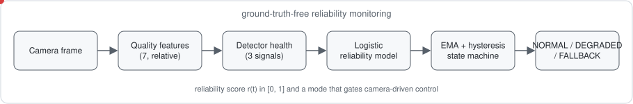
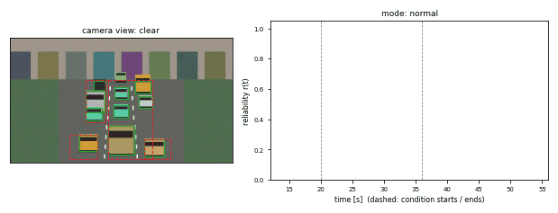
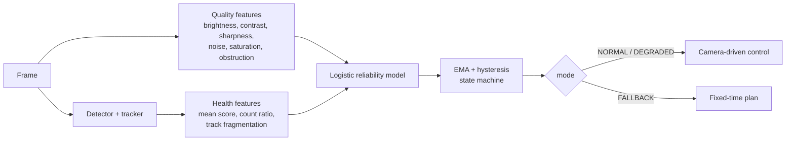
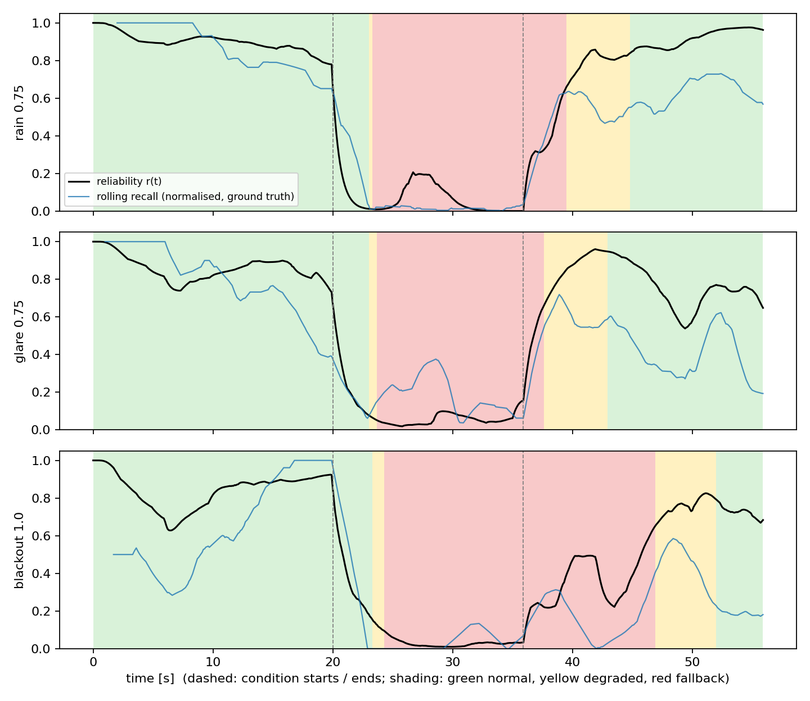

# perception-reliability-monitor

**Ground-truth-free reliability monitoring and graceful degradation for camera-based traffic
perception.**

A signal controller that trusts a camera at 2 a.m. in the rain is only as safe as that camera's
worst moment. This package answers one question *without labels at run time*: **can the current
perception output be trusted right now?** It turns image-quality statistics and detector-side health
signals into a calibrated reliability score `r(t)` in [0, 1] and a three-state mode (NORMAL,
DEGRADED, FALLBACK) with hysteresis, so that a controller can switch to a fixed-time plan when the
camera cannot be trusted.

[](https://github.com/soheylfalahzade/perception-reliability-monitor/actions)


<p align="center"></p>

<p align="center"></p>

<sub>Animation: a stream that starts clear, enters rain (dashed lines) and returns to clear. Left: the degraded frame with ground-truth (green) and detected (red, dashed) boxes. Right: reliability r(t) with mode shading. The first seconds show the warm-up of the health windows. Regenerate with `relmon-gif`.</sub>



## Components

| module | role |
|---|---|
| `quality.py` | seven reference-free features, expressed relative to a clear-weather calibration (zero when nothing changed): log brightness, contrast, sharpness, noise, dynamic range, saturated-pixel fraction, persistent lens-obstruction fraction |
| `health.py` | greedy IoU tracker and rolling detector-health features: mean confidence, count ratio against a clear reference, track births per detection |
| `monitor.py` | `ReliabilityModel` (standardised logistic regression, IRLS) and `ReliabilityMonitor` (EMA, asymmetric dwell times: fall back quickly, recover cautiously) |
| `scene.py`, `degrade.py` | synthetic fixed-camera road scene with exact boxes; night, rain, fog, glare, lens dirt and camera blackout at adjustable severity |
| `detector.py` | a deliberately simple classical detector (background differencing); stand-in for any perception module whose quality really depends on the pixels |
| `dataset.py`, `evaluate.py` | labelled clips, continuous clear -> bad -> clear streams, metrics |
| `sumo_control.py` | closed-loop SUMO study with four control policies |

The monitor is detector-agnostic: it needs frames and the detector's boxes and scores.

## Installation (Ubuntu / WSL2)

```bash
python3 -m venv .venv && source .venv/bin/activate
pip install -e ".[dev]"
pip install -e ".[sumo]"    # optional, for the closed-loop study
pytest
```

## Usage

```bash
relmon-eval --dev-seeds 3 --test-seeds 6 --out results/eval          # about 12 min, one core
relmon-sumo --sumocfg examples/sumo/cross_heavy.sumocfg --severity 1.0 --seeds 4 --jobs 3 \
            --out results/sumo                                        # needs the sumo extra
```

```python
from relmon import ReliabilityMonitor, MonitorConfig, QualityExtractor, DetectorHealth
quality.calibrate(clear_frames)                        # once, in clear weather
x = np.concatenate([quality.extract(frame), health.update(detections)])
r, mode = monitor.update(x)                            # per frame
```

## Evaluation protocol

**Data.** Frames are rendered from a synthetic scene (320 x 180, three lanes, moving vehicles with
exact boxes), degraded by five conditions plus a camera blackout at severities 0.25-1.0, and passed
through the reference detector. The label of a frame is *reliable* if the rolling (30-frame) recall
is at least 0.6 times the camera's own clear-weather recall (0.30 for a clear recall of 0.49).
Labels are used only for training and evaluation, never at run time.

**Protocol.** Models are trained on 3 development seeds (1000+) and evaluated on 6 disjoint test
seeds (14,901 frames, 63% reliable). Streams for the mode analysis are continuous (clear 20 s, bad
16 s, clear 20 s) so that health and obstruction state persist.

## Results (synthetic images)

**What the reference detector does under each condition** (recall / precision over test clips):

| condition | 0.25 | 0.5 | 0.75 | 1.0 |
|---|---|---|---|---|
| clear | 0.46 / 0.55 | | | |
| night | 0.53 / 0.54 | 0.68 / 0.59 | 0.62 / 0.59 | 0.54 / 0.44 |
| rain | 0.48 / 0.54 | 0.55 / 0.50 | 0.02 / 0.06 | 0.01 / 0.02 |
| fog | 0.67 / 0.60 | 0.59 / 0.55 | 0.75 / 0.59 | 0.46 / 0.61 |
| glare | 0.15 / 0.19 | 0.14 / 0.25 | 0.06 / 0.12 | 0.01 / 0.01 |
| dirt | 0.55 / 0.51 | 0.50 / 0.33 | 0.32 / 0.22 | 0.28 / 0.19 |
| blackout | 0.60 / 0.54 | 0.64 / 0.58 | 0.52 / 0.55 | 0.04 / 0.11 |

Night, fog and moderate blackout do not hurt this detector (it normalises each frame
photometrically); rain, glare, dirt and a full outage do.

**Frame-level reliability prediction** (held-out):

| features | AUC | ECE |
|---|---|---|
| image quality only | 0.873 | 0.070 |
| detector health only | 0.901 | 0.078 |
| **combined** | **0.938** | **0.049** |

Per-condition AUC of the combined model: clear 0.93, night 0.84, rain 0.98, fog 0.88, glare 0.82,
dirt 0.83, blackout 0.96.

**Mode behaviour on continuous streams** (fraction of the bad segment, and of the clear segments
after a 8 s warm-up, spent in FALLBACK; delay = time from onset to first FALLBACK):

| stream | FALLBACK in bad | NORMAL in bad | FALLBACK in clear | delay |
|---|---|---|---|---|
| rain 0.5 | 0.51 | 0.12 | 0.00 | 3.3 s |
| rain 0.75 | 0.79 | 0.19 | 0.11 | 3.3 s |
| glare 0.5 | 0.78 | 0.17 | 0.01 | 3.6 s |
| glare 0.75 | 0.77 | 0.19 | 0.05 | 3.7 s |
| dirt 0.75 | 0.49 | 0.23 | 0.17 | 8.1 s |
| blackout 1.0 (outage) | 0.73 | 0.21 | 0.34 | 4.3 s |
| night 0.75, fog 0.5, blackout 0.75 | 0.00 | 1.00 | 0.00 | none |



The monitor reacts within 3-8 s when the detector actually fails and stays quiet when the detector
copes (night, mild fog). It also produces false fallbacks after a bad episode (up to 0.34 of the
following clear segment after an outage), because detector-health windows and the obstruction
average recover slowly.

## Closed-loop study in SUMO

A two-phase intersection (780 and 640 veh/h) is controlled by: **fixed** (30 s / 30 s), **oracle**
(adaptive rule on true queues), **blind** (the same rule on camera-estimated queues), and
**monitor** (blind, but fixed-time while any camera is in FALLBACK). Camera estimates are drawn from
the *measured* count ratios of the detector under each condition; monitor inputs are drawn from the
measured feature banks. The adaptive rule (minimum green 15 s, switch margin 3 vehicles) was tuned on
development seeds so that the oracle beats fixed time; reported seeds are 0-3. Mean travel time (s),
severity 1.0, both cameras degraded unless marked:

| scenario | fixed | oracle | blind | monitor |
|---|---|---|---|---|
| clear | 63.3 | 57.6 | 57.6 | 57.6 |
| rain | 63.3 | 57.6 | 57.9 | 63.3 |
| glare | 63.3 | 57.6 | 57.8 | 63.3 |
| dirt | 63.3 | 57.6 | 57.6 | 59.2 |
| blackout | 63.3 | 57.6 | 57.7 | 63.3 |
| rain, W camera only | 63.3 | 57.6 | 57.9 | 63.3 |
| blackout, W camera only | 63.3 | 57.6 | 57.7 | 63.3 |
| intermittent rain | 63.3 | 57.6 | 57.8 | 59.6 |
| **worst case over 12 scenarios** | 63.3 | 57.6 | 57.9 | 63.3 |

**This is a negative result for the monitor in this setting.** Even under the worst conditions the
blind policy stays within 0.3 s of the oracle, so the monitor's fallback to fixed time only costs
about 5.7 s (9%) in the conditions it flags. The measured count distortions (roughly 0.4x-2.5x of the
true count, with similar bias on both approaches and a rule that only compares queues) are too mild
to hurt this controller, and the blackout noise leaves false detections, so counts do not collapse
to zero. The monitor detects the failures (see above); this experiment does not show that detecting
them improves control. Controllers that depend on absolute counts, on per-approach capacity, or on
detector-triggered actuation would be more exposed; testing them is future work.

## Claims and evidence

| claim | evidence | file |
|---|---|---|
| Image quality and detector health jointly predict reliability | AUC 0.938 (combined) vs 0.873 (quality) and 0.901 (health); ECE 0.049 | `docs/results/eval_results.json` |
| The monitor reacts when the detector fails | FALLBACK within 3-8 s for rain, glare and outage; stays NORMAL for night and mild fog | `docs/results/eval_results.json` |
| The monitor limits false fallbacks | **partially supported**: 0-0.17 of clear frames, up to 0.34 after an outage | `docs/results/eval_results.json` |
| Monitoring improves closed-loop control | **not supported**: blind control is within 0.3 s of oracle; fallback costs about 5.7 s | `docs/results/sumo_summary.json` |

## Threats to validity

- *Construct*: images are synthetic and the reference detector is a simple classical method; deep detectors fail differently.
- *Internal*: the reliable label depends on a relative threshold (0.6 x clear recall); monitor thresholds and dwell times were not tuned.
- *External*: one scene geometry; closed-loop camera behaviour resamples measured frame statistics independently in time.
- *Statistical*: 6 test seeds for frame-level metrics and 4 for the closed loop; no intervals are reported for the mode statistics.

## Data and code availability

All code, configuration, seeds and result files behind the figures and tables are in this repository.
No external datasets are used. Formal definitions: [`docs/METHODS.md`](docs/METHODS.md); exact
commands, seeds and runtimes: [`docs/REPRODUCIBILITY.md`](docs/REPRODUCIBILITY.md).

## Citation

See [`CITATION.cff`](CITATION.cff).

## Limitations and scope

- Images are **synthetic** and the reference detector is deliberately simple; no real adverse-weather
  footage was used. Conclusions about *which* conditions are harmful belong to this detector, not to
  deep detectors, which fail differently.
- Condition severities are generated, not measured; the closed-loop camera model resamples measured
  frame statistics independently in time.
- The reliable/unreliable label depends on the chosen fraction (0.6) of clear-weather recall.
- Monitor thresholds and dwell times were set a priori and not tuned for false-fallback rate.
- The scene has a single camera geometry.

## Roadmap

Real adverse-weather footage (e.g. public night/rain subsets) with a modern detector; a controller
that is sensitive to absolute counts; recalibration of the monitor thresholds against a target
false-fallback rate; per-camera online recalibration.

## License

MIT. See [LICENSE](LICENSE).
